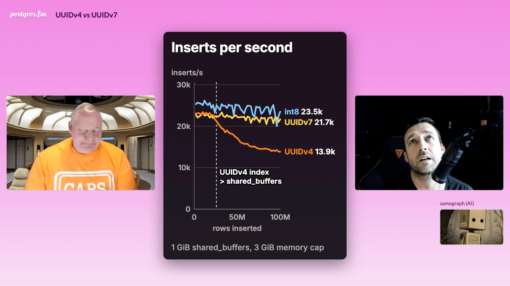
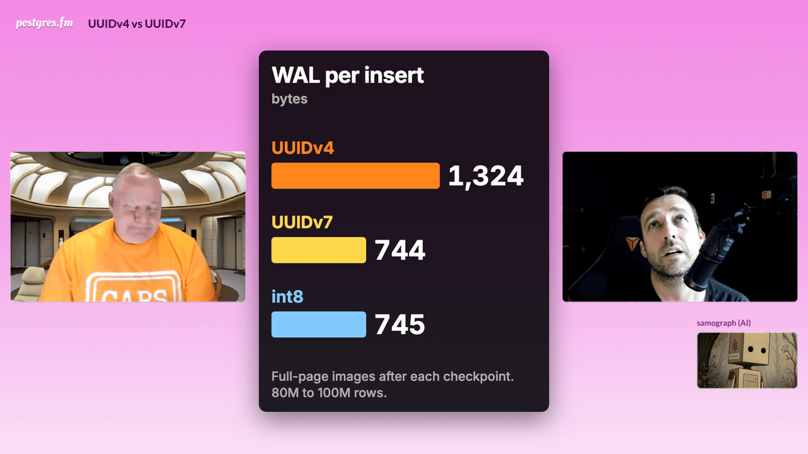
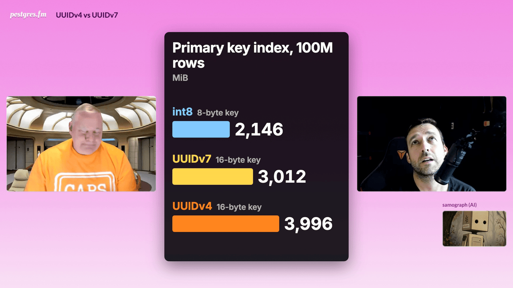

# UUIDv4 vs UUIDv7: on-screen illustrations

[Episode overview](README.md)

The video version has eight cards. Four are bands at the bottom of the frame; four are charts or diagrams in the center, with the hosts moved to the sides. Each card appears while the hosts talk about the same point and stays at least 20 seconds. The colors are the same on every card: UUIDv4 orange, UUIDv7 yellow, `int8` light blue.

Times are in the YouTube version, which starts with a 13-second title card. Each still is one frame from the edited video, taken after the card has finished drawing.

The numbers come from the DBLab Forge case `uuid-pk-v4-v7-01` (CC BY 4.0, PostgresAI): the [brief](https://console.postgres.ai/shared/brief/9fffe2da-00c1-470b-a79d-a210ae2306bc) and the [public case directory in forge-results](https://gitlab.com/postgres-ai/forge-results/-/tree/main/cases/uuid-pk-v4-v7-01), currently in review as [merge request !2](https://gitlab.com/postgres-ai/forge-results/-/merge_requests/2). File names below are relative to that case directory. All runs were on Postgres 18 on Hetzner Cloud servers on 2026-10-26, one run per cell. Memory tiers: "small" is `shared_buffers = 1GB` with a 3 GiB memory cap; "tiny" is `shared_buffers = 512MB` with a 1.5 GiB cap.

## 1. UUID versions

**Time:** 00:10:18, about 30 s. Band.

**Shows:** two example UUIDs in monospace. `UUIDv4 8b1f3c5e-2d7a-4c91-b3e8-6f0a9d42c718` with the version digit 4 highlighted, and `UUIDv7 01a17e51-80a8-7b3d-9e21-4c6a8d0f5b17` with the version digit 7 highlighted and the first 12 hex digits underlined and labeled `time`.

**Numbers and source:** the two values are made-up examples, not taken from the experiment. The layout follows [RFC 9562](https://www.rfc-editor.org/rfc/rfc9562): a UUIDv7 starts with a 48-bit Unix timestamp in milliseconds (12 hex digits), and the version number is the first digit of the third group.

## 2. What stays in memory, then inserts per second

**Time:** 00:15:20, about 82 s. Center, two phases.

**Shows:** first, "What stays in memory" (`1 GiB shared_buffers, 100M rows`): three stacked bars of how much of the primary key index and of the table is in `shared_buffers`. UUIDv4 index 767 MiB, table 50 MiB; UUIDv7 89 and 475 MiB; `int8` 69 and 485 MiB. The UUIDv4 index pushes the table out of the cache.

Then "Inserts per second": inserts/s (0 to 30k) against rows inserted (0 to 100M), one line per key type. End labels `int8 23.5k`, `UUIDv7 21.7k`, `UUIDv4 13.9k`. A dashed marker at about 25.85M rows reads `UUIDv4 index > shared_buffers`. Caption: `1 GiB shared_buffers, 3 GiB memory cap`.

**Numbers and source:**
- Cache contents at 100M rows: run 1, small tier, `analysis/r1_summary.csv` (columns `pkey_resident_mib_100m`, `heap_resident_mib_100m`).
- Insert-rate lines: run 6 (wave 6), small tier, 100M rows per arm, `analysis/r6_series.csv` (column `tps_window`, 10-second samples, excluding samples flagged as stalled or confounded). Each line is the mean over the servers that ran that key: UUIDv4 on three (p1, p3, x1), UUIDv7 on two (p1, p3), `int8` on one (x1). The end labels match the mean rate between 98M and 100M rows (our recomputation from the same file). Different servers have different fsync speed, so the gap between the `int8` and UUIDv7 lines is partly the server, not the key.
- The marker: the UUIDv4 index passed 1 GiB between 25.6M and 26.1M rows, depending on the run (25.6M in run 1).

## 3. B-tree: random leaf vs last leaf

**Time:** 00:18:02, about 70 s. Center, animation.

**Shows:** two small B-trees (a root, two inner pages, eight leaves). Top, `UUIDv4: random leaf`: new keys land on random leaves. Once the index no longer fits in memory, some leaves are on disk (dashed); inserting into one reads it in and pushes another leaf out. Bottom, `UUIDv7: always the last leaf`: new keys go only to the rightmost leaf, and a new leaf is added on the right when it fills. A tag marks this as the same pattern as `int8`.

**Numbers and source:** none. The mechanism is from the brief, section 3. The tree is a schematic, not the real index shape (the real indexes have three levels at 100M rows, `analysis/r1_btree_health.csv`).

## 4. UUIDv7 inserts as fast as int8

**Time:** 00:20:13, about 26 s. Band.

**Shows:** `UUIDv7 inserts as fast as int8`, with the line `23,458 vs 23,131 inserts/s, same box`.

**Numbers and source:** `analysis/r2_cross_run.csv` and the brief, section 9. UUIDv7 in run 2 (tiny tier) and `int8` in run 1 (small tier) on the same server, p3, over the first 71.35M rows. The tiers differ. On other servers the UUIDv7/`int8` ratio was 0.947 to 1.279 (run 4, `analysis/r4_replication_pastcap.csv`); the case README explains why server differences dominate this comparison.

## 5. WAL per insert

**Time:** 00:21:40, about 58 s. Center, three bars.

**Shows:** WAL bytes per insert from 80M to 100M rows: UUIDv4 1,324, UUIDv7 744, `int8` 745. Caption: `Full-page images after each checkpoint. 80M to 100M rows.`

**Numbers and source:** run 1, small tier, `analysis/r1_windows_20m.csv` (column `wal_bytes_per_row`, window 80-100M). The same window has 145 full-page images per 1,000 inserts for UUIDv4 and 40 for UUIDv7 (column `fpi_per_1k_rows`). `wal_compression` was off in these runs.

## 6. "Just switch to UUID v7s."

**Time:** 00:32:01, about 22 s. Band.

**Shows:** the quotation `"Just switch to UUID v7s."`

**Numbers and source:** none. Kirk Wolak says this on air at the same moment.

## 7. Primary key index size

**Time:** 00:41:07, about 32 s. Center, three bars.

**Shows:** `Primary key index, 100M rows`, in MiB: `int8` 2,146 (8-byte key), UUIDv7 3,012 (16-byte key), UUIDv4 3,996 (16-byte key).

**Numbers and source:** run 1, small tier, `analysis/r1_summary.csv` (column `pkey_mib_100m`). Key sizes from the brief, section 6. The UUIDv4 index is larger than UUIDv7's because its leaves are about 68% full after random splits, against about 90% for UUIDv7 and `int8` (`analysis/r1_btree_health.csv`). On air, one host says a UUID is 18 bytes; it is 16 bytes, as the card shows.

## 8. Keep the uuid type

**Time:** 00:45:26, about 25 s. Band.

**Shows:** `Keep the uuid type. Change only the default.`, with the line `uuidv7() is in Postgres 18`.

**Numbers and source:** none. `uuidv7()` was added to Postgres 18 in [commit 78c5e141e9c1](https://git.postgresql.org/gitweb/?p=postgresql.git;a=commit;h=78c5e141e9c1) and is documented in [UUID functions](https://www.postgresql.org/docs/18/functions-uuid.html). It returns the `uuid` type, so an existing `uuid` column only needs a new default.

