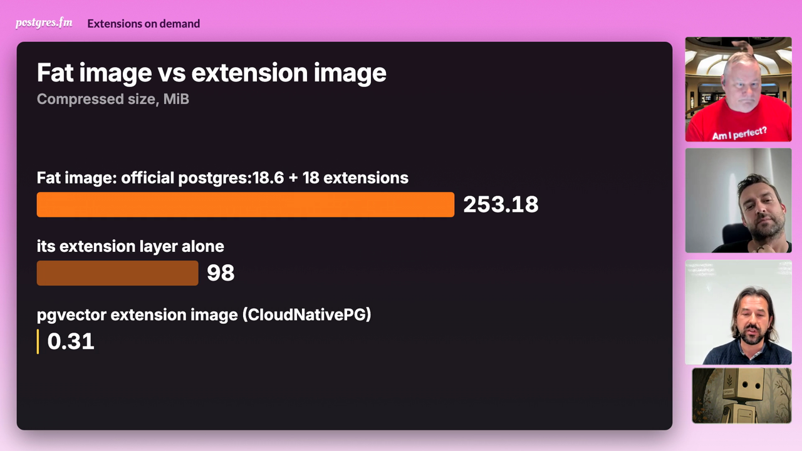
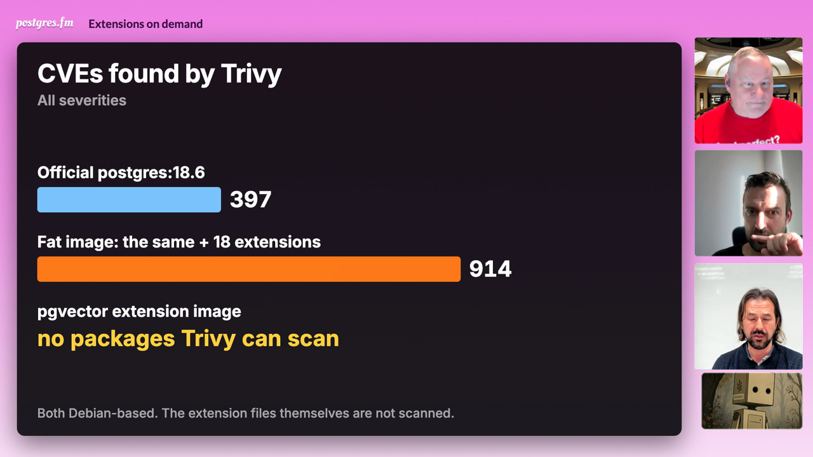
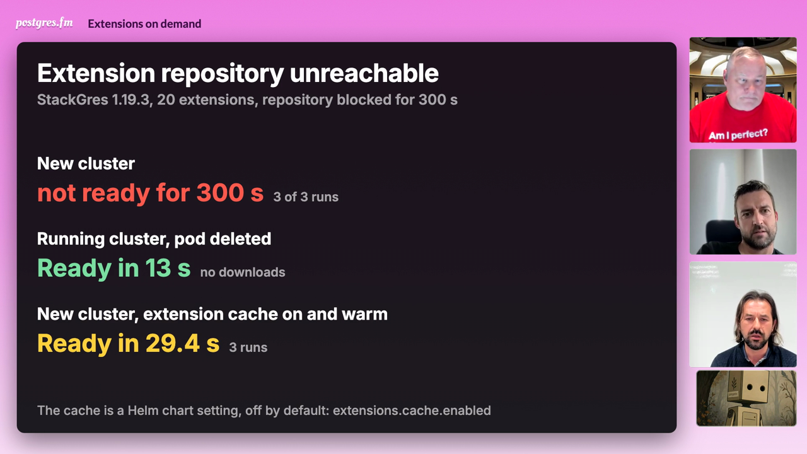
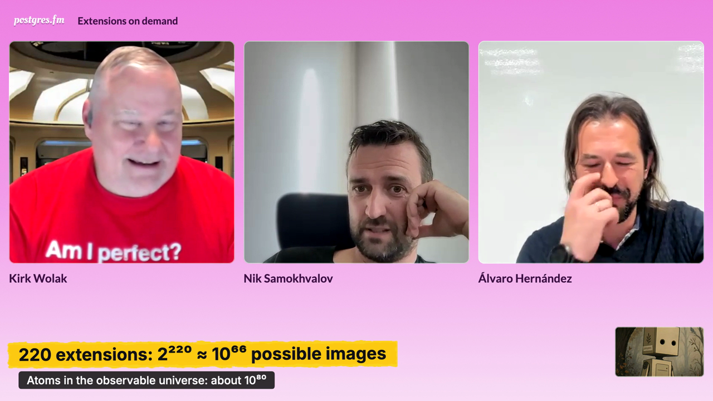
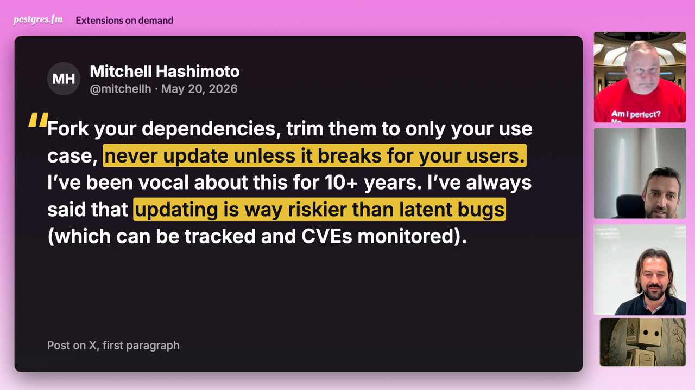
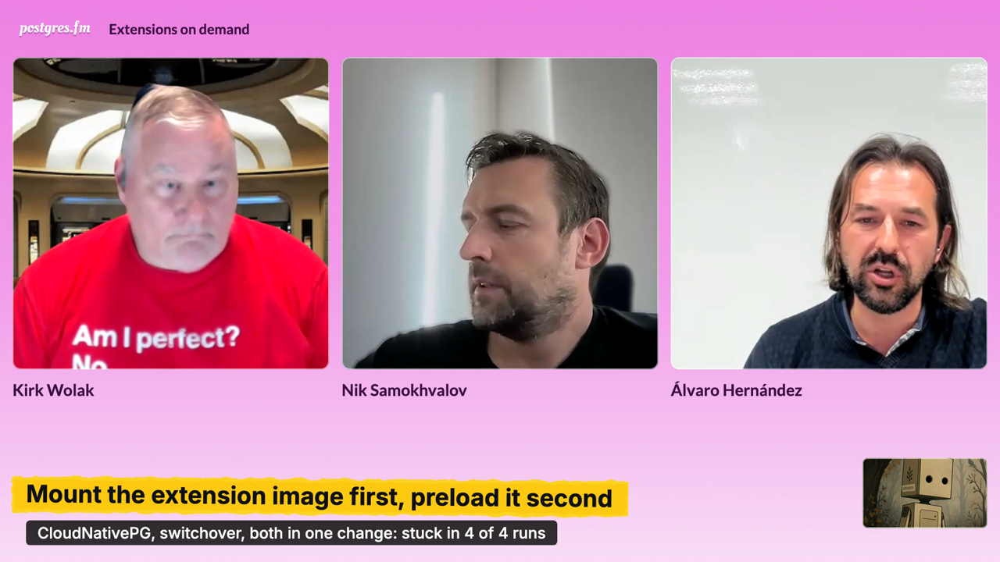
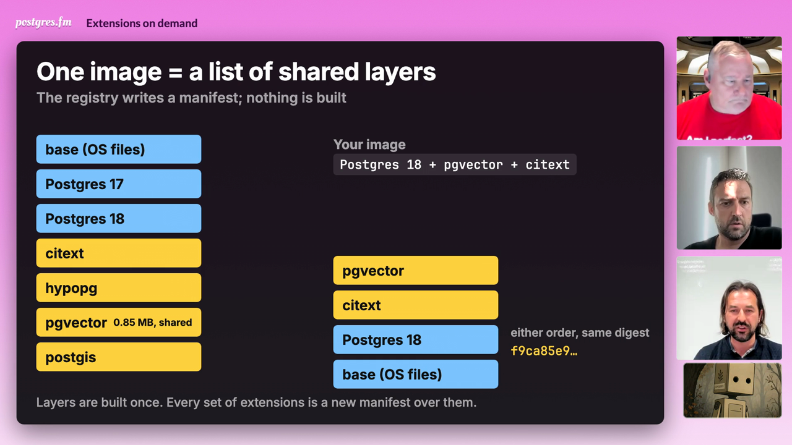
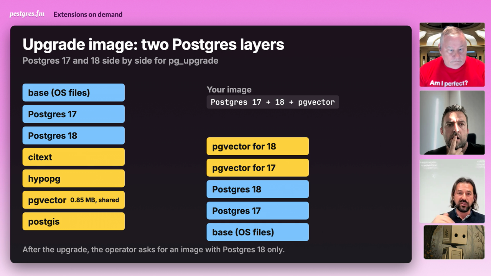
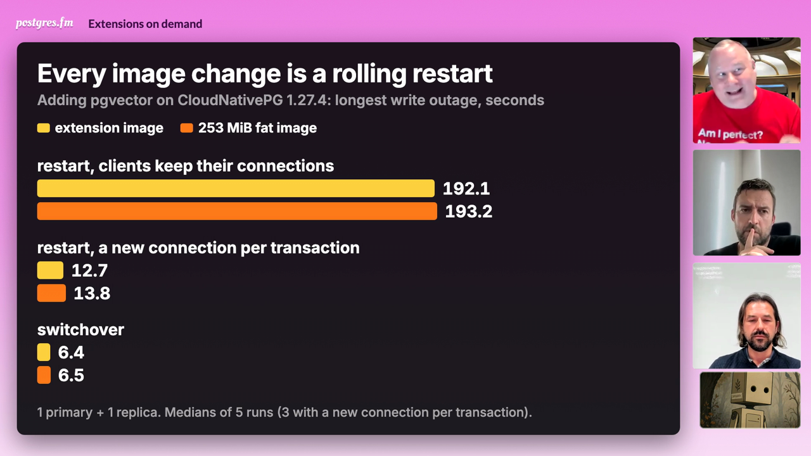

# Extensions on demand: on-screen illustrations

The video version has seven cards. Two are bands at the bottom of the frame. Five are charts, diagrams or a quote in the center; for those the three faces move to a column on the right, above the robot tile. Each card appears while the hosts talk about the same point and stays at least 25 seconds. The colors are the same on every card: fat image orange, extension image yellow, official or base image light blue.

Times are in the YouTube version, which starts with a 13-second title card. Each still is one frame from a preview render of the edited video, taken after the card has finished drawing.

Most numbers come from the DBLab Forge brief "Dynamic containers for PostgreSQL: what we measured" ([brief](https://console.postgres.ai/shared/brief/c501d438-b872-4705-89a6-bdab30ea1680), cases `dynamic-containers-01` and `dynamic-containers-02`, PostgresAI). Case 01 ran on one Hetzner ccx23 node on 2026-11-03; case 02 ran on Hetzner ccx33 nodes on 2026-11-04. Section names below are the brief's. The brief is marked draft; its run records are on a draft merge request that is not public yet.

## 1. Fat image vs extension image, then CVEs

**Time:** 00:18:54, about 91 s. Center, two phases.

**Shows:** first, "Fat image vs extension image" (`Compressed size, MiB`): three bars. Fat image (official `postgres:18.6` plus 18 extensions) 253.18, its extension layer alone 98, the CloudNativePG pgvector extension image 0.31.

Then, when Álvaro says there may be plenty of CVEs, "CVEs found by Trivy" (`All severities`): official `postgres:18.6` 397, fat image 914, pgvector extension image `no packages Trivy can scan`. Caption: `Both Debian-based. The extension files themselves are not scanned.`

**Numbers and source:** brief, section 2 (run E1): compressed MiB 253.18 and 0.31 (CNPG pgvector 0.8.7), Trivy 0.76.1 totals 397 and 914, and "0 / 0 / 0 (no package database)" for the extension images. The 98 MiB layer is from section 1, key numbers ("18 PGDG extensions as one layer on the official 18.6 image"). The brief notes that the fair comparison is the extension delta (98 MiB), not the whole fat image, and that Trivy cannot scan the extension files, which is why the card does not show "0 CVEs". On air Álvaro says a fat image with all extensions measured "several gigabytes"; that was their own measurement, and the card's fat image has 18 extensions only.

## 2. Extension repository unreachable

**Time:** 00:24:28, about 27 s. Center.

**Shows:** "Extension repository unreachable" (`StackGres 1.19.3, 20 extensions, repository blocked for 300 s`). Three rows, staged: `New cluster: not ready for 300 s` (3 of 3 runs); `Running cluster, pod deleted: Ready in 13 s` (no downloads); `New cluster, extension cache on and warm: Ready in 29.4 s` (3 runs). Caption: `The cache is a Helm chart setting, off by default: extensions.cache.enabled`.

**Numbers and source:** brief, section 0, follow-up round: "StackGres with the repository unreachable, n = 3 per case" (cases a and b: "patroni not ready for 300 s (3 of 3)", "Ready 13 s (9-13) after the delete, 0 download lines"), and the rerun with IPv4 and IPv6 blocked ("cache warm", 29.4 s to 19 of 19 extensions, n = 3; also in the key numbers). The cache section says the cache is deployed by the Helm chart value `extensions.cache.enabled`, default off. Álvaro says at the same moment that extensions are downloaded only when a new cluster is created.

## 3. 2^220 possible images

**Time:** 00:26:59, about 26 s. Band.

**Shows:** `220 extensions: 2²²⁰ ≈ 10⁶⁶ possible images`, with the line `Atoms in the observable universe: about 10⁸⁰`.

**Numbers and source:** Nik says this on air ("two to a power of this 200 something ... 10 power 66 ... atoms in universe ... 80 zeros"). 220 is the extension count Álvaro gives two minutes earlier ("220 something"). 2^220 = 1.7 x 10^66. About 10^80 atoms is the usual estimate for the observable universe.

## 4. Mitchell Hashimoto: never update unless it breaks

**Time:** 00:36:34, about 50 s. Center, quote.

**Shows:** a quote card: `Mitchell Hashimoto`, `@mitchellh · May 20, 2026`, and the first paragraph of the post: "Fork your dependencies, trim them to only your use case, never update unless it breaks for your users. I’ve been vocal about this for 10+ years. I’ve always said that updating is way riskier than latent bugs (which can be tracked and CVEs monitored)." Two phrases are highlighted when Nik paraphrases them: "never update unless it breaks for your users." and "updating is way riskier than latent bugs". Footer: `Post on X, first paragraph`.

**Numbers and source:** [the post on X](https://x.com/mitchellh/status/2057171518027887035), 2026-05-20 18:48 UTC; text and date checked through X's public embed data on 2026-11-05. The post continues past this paragraph; the card shows the first paragraph only. Nik says on air that the tweet is on screen and paraphrases it as "pin the versions and not upgrade and verify all the upgrades". The post says "never update" and "fork", not "pin"; it is the closest match we found, and Nik should confirm it is the one he meant.

## 5. Mount the extension image first, preload it second

**Time:** 00:38:52, about 30 s. Band.

**Shows:** `Mount the extension image first, preload it second`, with the line `CloudNativePG, switchover, both in one change: stuck in 4 of 4 runs`.

**Numbers and source:** brief, section 0, "A preload extension from an image": pgaudit from the CNPG pgaudit image plus `shared_preload_libraries: [pgaudit]` in one patch with switchover; the old primary crash-loops with `could not access file "pgaudit"` and the cluster does not recover in 4 of 4 runs (CNPG 1.27.4; the same on 1.30.1, n = 1). In two steps (image first, then the setting) switchover worked (n = 1). The CNPG 1.27 documentation warns against changing both at once. The card appears while Álvaro describes the Postgres 18 way to add extensions from separate paths and mount them, which is how CloudNativePG extension images work.

## 6. One image = a list of shared layers

**Time:** 00:41:38, about 101 s. Center, animation, two phases.

**Shows:** left, `Layers in the registry`: base (OS files), Postgres 17, Postgres 18, citext, hypopg, pgvector (`0.85 MB, shared`), postgis. Right, `Your image` for `Postgres 18 + pgvector + citext`: the base, Postgres 18, citext and pgvector layers move from the left into a stack as Álvaro names them. A note: `either order, same digest f9ca85e9…`. Caption: `Layers are built once. Every set of extensions is a new manifest over them.`

Then, at "major version upgrade": `Upgrade image: two Postgres layers` (`Postgres 17 and 18 side by side for pg_upgrade`). The stack becomes base, Postgres 17, Postgres 18, pgvector for 17, pgvector for 18. Caption: `After the upgrade, the operator asks for an image with Postgres 18 only.`

**Numbers and source:** the mechanism is as Álvaro describes it on air (43:17 to 45:00 in the recording). Brief, section 3 (run E2): `e/citext/pgvector` and `e/pgvector/citext` give the same digest (prefix `f9ca85e9`), the extension layers are sorted by name, and the pgvector layer is one blob of 0.85 MB shared by every composition with pgvector. The diagram is a schematic: the real manifests list the base layer twice and the layer names differ.

## 7. Every image change is a rolling restart

**Time:** 00:44:57, about 51 s. Center, grouped bars.

**Shows:** `Adding pgvector on CloudNativePG 1.27.4: longest write outage, seconds`, extension image (yellow) and 253 MiB fat image (orange). Restart with clients that keep their connections: 192.1 and 193.2. Restart with a new connection per transaction: 12.7 and 13.8. Switchover: 6.4 and 6.5. Caption: `1 primary + 1 replica. Medians of 5 runs (3 with a new connection per transaction).`

**Numbers and source:** brief, section 0, case 02 table, column "Longest rw outage, s" (k3s 1.36.5, CloudNativePG 1.27.4, pgbench at 100 TPS with 4 clients). The 192 to 193 s come from smart shutdown waiting for open sessions until `smartShutdownTimeout` (180 s). On one node with the base layers already there, the route (extension image or fat image) did not change the cost; a slow or distant registry was not tested. The card appears while Álvaro explains that a new image triggers a restart.

