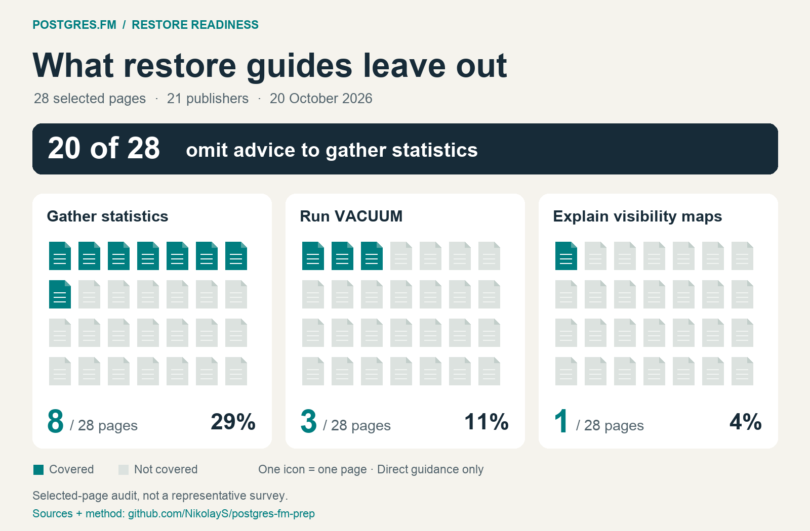

# Your restore finished. Is your database ready?

[All episodes](../../README.md)

Research and recording preparation for **“Your restore finished. Is your database ready?”** with Nikolay Samokhvalov and Kirk Wolak.

The question: what performance-relevant state is missing after a logical PostgreSQL dump/restore, what PG18 statistics transport changes, and what operators should verify before returning traffic.

## Start here

- [New Forge results and four charts](forge-results.md) — core matrix, normal autovacuum, first-read WAL, larger fixture, upgrade, extended statistics and COPY FREEZE.
- [Kirk's study pack](study-pack.md) — a short reading guide, core distinctions and co-host questions.
- [Expanded documentation audit](restore-docs-expanded.md) — 28 pages, all source URLs, positive counterexamples, counts and source metadata.
- [Autovacuum fairness](autovacuum-readiness.md) — PG13 improvements, asynchronous completion and possible plan symptoms.
- [Proposed maintenance option](maintenance-option.md) — why statistics transport is incomplete and what an opt-in pg_restore phase could do.
- [Research report](research.md) — historical discussions, PG18 defaults, visibility maps, version boundaries and operator considerations.
- [Additional DBLab Forge experiments](experiments.md) — a bounded plan for a few hours, with priorities, decisive measurements and stop rules.
- [Existing experimental observations](existing-observations.md) — what earlier synthetic examples show and what they do not.
- [Blog outline](blog-outline.md) — the article structure and evidence still needed.

## Documentation audit at a glance

[Expanded report: 28 pages](restore-docs-expanded.md) · [Original 12-page baseline](restore-docs-audit.md) · [Download image](assets/restore-docs-expanded-summary.png).

## Current status

Research was assembled on 2026-10-20 UTC. The next recording/article target is October 20, with study material needed that morning Pacific time.

The [Forge experiments have supplied results](forge-results.md), including the core matrix and additional tracks. The original plan is retained as a historical proposal. Public charts and selected evidence accompany the synthesis; single-run costs and unisolated explanations are qualified. No universal query-latency speedup is claimed.

PG18 is the core demonstration target. PG19 is a short, explicitly release-candidate-qualified follow-up unless the core work is complete early.
