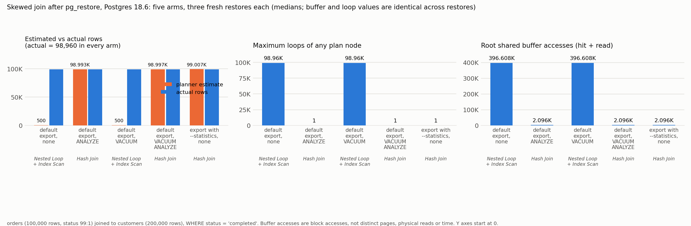
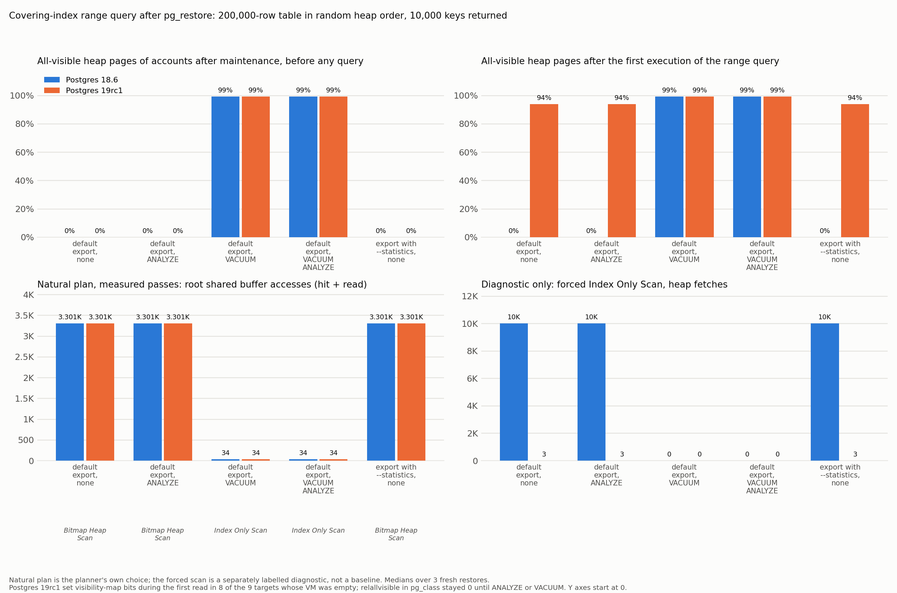
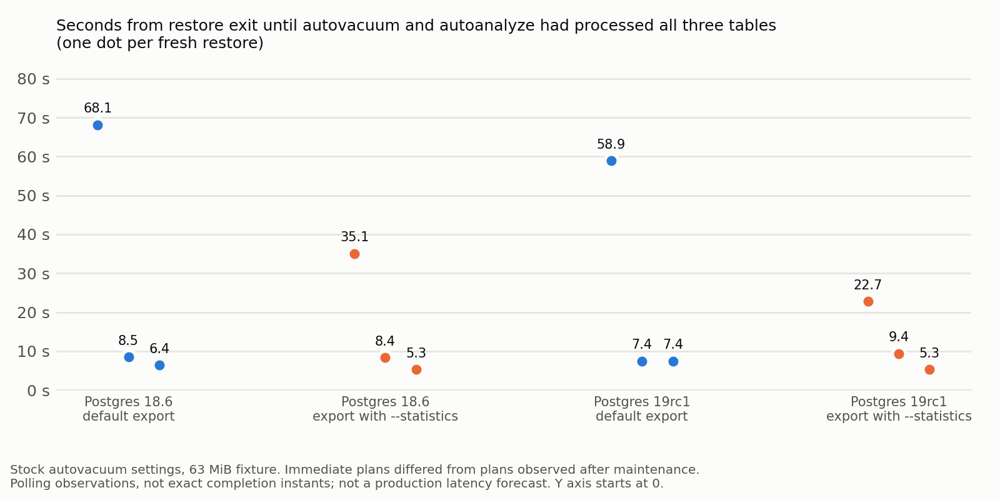
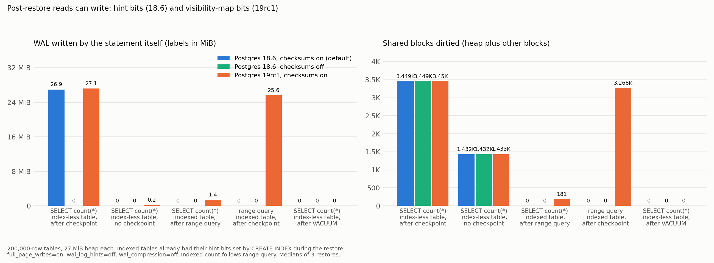

# Forge results: restore success versus workload readiness

[Episode home](README.md) · [Kirk's study pack](study-pack.md) · [Data and provenance](evidence/forge/README.md)

Results supplied October 19, 2026 Pacific time (October 20 UTC), from Forge case `restore-readiness-01`. This report separates measured results, explanations and open questions. The Forge sections synthesize supplied experiments; the separate PG19rc1 control below was newly executed and independently repeated. No confirmed PostgreSQL bug is claimed.

## The five points to use on air

1. **ANALYZE and VACUUM fixed different problems.** In the PG18 fixture, ANALYZE changed the join; VACUUM changed the covering-index query. VACUUM ANALYZE did both.
2. **Automatic maintenance really helped.** In twelve small-fixture restores, both automatic jobs were observed complete roughly 5–68 seconds after restore. This is a measured range, not a promised deadline.
3. **Statistics import is valuable but incomplete.** PG18 transported column and expression-index statistics; collected extended statistics remained missing. PG19rc1 transported those too. Neither logical restore copied the physical VM.
4. **The first reader can pay for writes.** Under the tested checksum/checkpoint conditions, a SELECT on a previously unread heap generated about 27 MiB of WAL. Prior vacuuming moved that work before the query.
5. **Readiness has a cost.** A larger fixture needed about four seconds of manual vacuuming and generated about 1.6 GB of cluster WAL in a deliberately checkpointed run. Background maintenance could finish during restore for some tables and several minutes afterwards for another.

All numbers below describe specific fixtures. Buffer accesses are not distinct pages, physical reads, elapsed time, or a universal speedup.

## 1. The core demonstration: two maintenance jobs

PG18.6, three fresh restores per arm; 63 MiB database; 200,000 accounts in random heap order; 100,000 orders joined to 200,000 customers. The covering query returns 10,000 keys. Per-table maintenance thresholds were elevated to isolate the commands while cluster autovacuum stayed enabled. Measured buffer totals were identical across the three restores.

| Archive and maintenance | Skewed join: natural plan / root buffer accesses | Covering query: natural plan / root buffer accesses |
| --- | --- | --- |
| Default, none | Nested Loop / 396,608 | Bitmap Heap Scan / 3,301 |
| Default, ANALYZE | Hash Join / 2,096 | Bitmap Heap Scan / 3,301 |
| Default, VACUUM | Nested Loop / 396,608 | Index Only Scan / 34, zero heap fetches |
| Default, VACUUM ANALYZE | Hash Join / 2,096 | Index Only Scan / 34, zero heap fetches |
| `pg_dump --statistics`, none | Hash Join / 2,096 | Bitmap Heap Scan / 3,301 |

The join estimated 500 rows without column statistics, against 98,960 actual, and made 98,960 inner probes. ANALYZE or statistics import produced estimates near the actual count. VACUUM alone did not correct that distribution estimate. PG17.11 reproduced the four default-archive arms; its pg_dump lacks statistics export.

Chart 2 shows medians. PG19rc1 reads populated VM bits in eight of nine initially empty targets; one target did not follow that pattern. The suggested checkpoint explanation is source-based, not an isolated causal experiment. Natural plans still remained bitmap scans while the catalog visibility estimate stayed zero. Forced scans are diagnostics, not the natural-plan baseline. [Core measurement CSV](assets/forge/measurements.csv), [physical and catalog state CSV](assets/forge/state.csv).

## 2. Fairness: normal autovacuum catches up

The new control removed the elevated table thresholds before loading and used the stock trigger and cost settings. Six restores on PG18.6 and six on PG19rc1 covered default and statistics-enabled archives. Immediate plans had the expected missing-statistics/visibility symptoms; after automatic vacuum and analysis, both queries matched the maintained arms.

**Timing correction:** the supplied summary originally labelled loop counters as seconds (6–67). The figure here uses differences between the recorded restore-exit timestamp and the first successful completion poll, approximately **5–68 seconds**. Polling observes completion after it happens and introduces uncertainty. Intermediate plans were not continuously measured. Do not infer that statistics-enabled dumps make autovacuum faster from this tiny, scheduling-sensitive sample. [Corrected timing evidence](assets/forge/stock-times.csv).

The larger fixture makes the limitation tangible: automatic maintenance of `customers` and `orders` finished before restore exited, so the first join already used a Hash Join. The accounts vacuum finished about 382 seconds after restore; analysis finished about 384 seconds after restore. The first poll confirming both was about 384 seconds after restore. The vacuum itself took 96.24 seconds; roughly 286 seconds preceded its start. Other large databases were being maintained on the same cluster, so worker contention and launcher scheduling confound this arrival time. It is not a clean measurement of an isolated database's autovacuum latency.

**Kirk's question:** “If autovacuum eventually repairs this, what does our traffic-switch procedure wait for?” [Autovacuum context](autovacuum-readiness.md).

## 3. PG18 imported statistics: useful, with two distinct gaps

### Collected extended statistics versus expression-index statistics

Separate 300,000-row fixture, two restores per arm on PG18.6 and PG19rc1. Values below are first-restore estimates; ANALYZE resampling varies between runs.

| Query / statistics needed | Actual | PG18 source estimate | PG18 default restore | PG18 stats restore | PG18 stats + ANALYZE |
| --- | ---: | ---: | ---: | ---: | ---: |
| Correlated region/country predicate | 10,213 | 10,090 | 8 | 3,371 | 10,050 |
| Distinct region/country groups | 20 | 20 | 30,000 | 100 | 20 |
| Date expression index predicate | 794 | 819 | 1,500 | 819 | 819 |
| Lowercase expression index predicate | 10,213 | 10,090 | 1,500 | 10,090 | 10,050 |
| Ordinary column predicate | 2,974 | 3,170 | 1,500 | 3,170 | 3,000 |

PG18 restored CREATE STATISTICS definitions, but `pg_statistic_ext_data` remained empty until ANALYZE. Expression-index statistics did arrive. On PG19rc1, three extended-statistics import calls restored ndistinct, dependencies and MCV data; the correlated-predicate estimate matched that version's source estimate of 10,250. Do not equate “extended statistics” with “expression-index statistics.” [Published state and estimate evidence](evidence/forge/README.md), [PG18 documented exclusions](https://www.postgresql.org/docs/18/app-pgdump.html).

### Imported visibility counts can disagree with physical visibility

With **per-table `autovacuum_enabled = false` and cluster autovacuum on**, three PG18.6 restores reproduced the earlier diagnostic: imported `relallvisible = 3449`, actual all-visible VM pages = 0. The natural Index Only Scan fetched 10,000 heap tuples and made 10,032 root buffer accesses. The default archive chose a Bitmap Heap Scan with 3,301 accesses. With normal table settings, index creation refreshed the estimate to zero instead.

This is a candidate planning concern, not a wrong-results finding or an isolated single-field proof. Dump ordering, statistics and settings all matter; the PG18 comparison did not isolate only `relallvisible`. The new PG19rc1 control below does. [Additional-track CSV](assets/forge/tracks_measurements.csv).

**Do not say hackers overlooked it.** Importing the field and preserving relation statistics through index creation were deliberate: [Stephen Frost, March 8, 2024](https://www.postgresql.org/message-id/Zer%2B8KR36gzST29w%40tamriel.snowman.net); [Jeff Davis, March 4, 2025](https://www.postgresql.org/message-id/ca81cbf6e6ea2af838df972801ad4da52640a503.camel%40j-davis.com). [Ashutosh Bapat, March 5, 2025](https://www.postgresql.org/message-id/CAExHW5sEjLx-8r85%2Br%3DmL%3Do4jVx2Y0D-mRzGTZxcfNm4YSeRSQ%40mail.gmail.com) cautioned that refreshing statistics improves plans. Our search did not find explicit discussion of this precise empty-VM/index-only-cost consequence; that is not proof of absence.

### New: isolated PG19rc1 control, independently reproduced

Two fresh PG19rc1 container runs changed only `relallvisible` after restoring the same archive twice. With imported 345 versus control 0, both actual VMs initially empty, the natural plans were Index Only Scan versus Bitmap Heap Scan. First-query root buffer accesses were nearly equal: **648 versus 644**. After both reads established 319 VM bits, the second executions used **7 versus 325** accesses; IOS heap fetches fell from 323 to 4. This confirms plan sensitivity but does **not** demonstrate a PG19 slowdown or prove zeroing the count is better.

A useful upstream question: preserve this estimate when heap/VM state transfers together (pg_upgrade), and derive it from destination state after logical reload? PG19's read-time VM updates complicate that policy. [Exact reproducer, both execution logs, build identity and limits](evidence/pg19-relallvisible/README.md). The separate PG18 Forge observations above retain their own version and experimental scope.

## 4. First SELECT: reads can cause writes

**Detailed explanation for the episode:** [hint bits, full-page images, checkpoint controls, and PG19 VM writes](first-read-writes.md).

The [October 20 Forge follow-up](first-read-writes.md#forge-follow-up-why-this-bookkeeping-needs-crash-protection) explains commit-status caching, torn-page protection, and PG19's distinct visibility WAL path. It also records corrections to overly broad claims about equal write amplification, COPY FREEZE and record attribution. This is new interpretation of existing runs.

Fourth table `events`: 200,000 rows, 3,480 heap pages, no index. Three fresh restores per treatment. `full_page_writes=on`, `wal_log_hints=off`, `wal_compression=off`; PG18.6 tested with checksums on and off; PG19rc1 only with checksums on. WAL here comes from **the statement's EXPLAIN WAL counters**.

| Statement / condition | Shared blocks dirtied | WAL bytes |
| --- | ---: | ---: |
| PG18.6, checksums on, first unindexed count after checkpoint | 3,449 | 28,251,777 |
| Same, no intervening checkpoint | 1,432 | 0 |
| PG18.6, checksums off, unindexed count after checkpoint | 3,449 | 0 |
| PG19rc1, checksums on, unindexed count after checkpoint | 3,450 | 28,466,854 |
| PG19rc1, no intervening checkpoint | 1,433 | 215,077 |
| These tested reads after VACUUM | 0 | 0 |

PG18's observed work is consistent with hint-bit updates and checksum-related full-page images. PG19rc1 additionally sets VM bits on eligible reads. Index creation had already visited the indexed heap, so PG18's range query did not repeat the hint-bit work. **The indexed-table count in the figure runs after the range query**; its PG19rc1 181 dirtied blocks are remaining work, not an independent first full-table read. Shared blocks dirtied can include VM blocks; they are not all heap pages.

On PG19rc1, ANALYZE after the reads refreshed `relallvisible` to 3,448 and the range plan became Index Only Scan: 35 buffer accesses, three heap fetches. On PG18.6 the corresponding count stayed zero and the plan stayed bitmap. This does not establish that every SELECT fills every VM bit or replaces VACUUM. [Additional measurements](assets/forge/tracks_measurements.csv).

## 5. Larger fixture: budget for readiness

PG18.6; 10 million accounts, 2 million customers, 1 million orders; 1,820 MiB including indexes; idle 4-vCPU host. Each step ran **once**. Autovacuum was off during timed maintenance comparisons, and a checkpoint preceded each maintenance command. These are operational examples, not benchmark rankings. WAL is a **cluster-wide LSN delta**, unlike the statement counters above.

| Operation | Wall seconds | Cluster WAL bytes |
| --- | ---: | ---: |
| Default restore, one job | 15.9 | 2,262,705,880 |
| Default restore, four jobs | 13.8 | 2,022,177,976 |
| ANALYZE | 0.4 | 689,176 |
| VACUUM | 4.0 | 1,594,924,432 |
| VACUUM ANALYZE | 4.1 | 1,595,341,456 |
| VACUUM FREEZE | 3.6 | 1,607,288,264 |
| vacuumdb, four jobs, analyze included | 4.1 | 1,595,343,928 |
| vacuumdb, four jobs, analyze only | 0.4 | 719,096 |

Do not infer that FREEZE is faster or parallel maintenance gives no benefit: these are single observations. Checkpoint/FPI conditions explain why maintenance WAL can be large; they do not establish a universal WAL overhead ratio. Manual staged ANALYZE targets 1, 10 and 100 repaired the join estimate progressively, but never populated the VM. The separate `vacuumdb --analyze-in-stages` invocation took about 0.8 seconds; the manual target timings are not measurements of its internal stages.

The larger covering query went from 9,769 root accesses to an Index Only Scan with **8,225 accesses and zero heap fetches**. Many accesses in the latter are repeated VM-buffer accesses as index entries point across six VM pages. Similar totals do not mean equivalent work. The join changed from 47,232 accesses to 21,104. [Step measurements](evidence/forge/runs/big_pg18/steps.csv), [raw plans](evidence/forge/README.md).

A statistics-enabled parallel restore produced an unresolved anomaly: two tables lost imported estimates while `orders` retained them. Its cause was not isolated. Do not generalize the serial restore explanation to that result.

## 6. Physical upgrade and COPY FREEZE are different paths

**pg_upgrade --link, PG17.11 → PG18.6:** two runs retained the physical VM (3,449 all-visible pages) and column statistics. The immediate covering plan was Index Only Scan, 34 accesses, zero heap fetches; content hashes matched. The missing-stats-only maintenance pass analyzed no user table in this fixture. Cumulative activity counters reset, and the new `relallfrozen` catalog field was zero. Extended statistics were not tested in this upgrade track. [Upgrade evidence](evidence/forge/README.md).

**COPY FREEZE:** three eligible bulk loads on each of PG18.6 and PG19rc1 produced 3,449 all-visible **and all-frozen** pages out of 3,480 immediately after load. Ordinary COPY produced zero. After index creation and ANALYZE, the frozen load used Index Only Scan with 34 accesses and zero heap fetches. A table created in an earlier transaction was rejected; truncating it in the current subtransaction allowed the load. Other eligibility conditions still apply. [COPY documentation](https://www.postgresql.org/docs/18/sql-copy.html), [measurements](assets/forge/tracks_measurements.csv).

This is a **custom bulk-load experiment**, not a pg_restore feature. The inspected archives used ordinary COPY; single-transaction restore does not itself add FREEZE. Nor does freezing collect optimizer distributions.

## Suggested episode sequence and remaining questions

- **Opening:** restore exits successfully; same answers, dramatically different work in the two core queries.
- **Demonstration:** show charts 1 and 2 together; explain ANALYZE versus VACUUM.
- **Fairness:** chart 4, then the larger run where smaller tables were ready before restore finished.
- **Surprise:** chart 3; the first SELECT may write. Ask when operators want to pay that cost.
- **Version boundaries:** PG18 expression/extended statistics, PG19rc1 read-time VM, pg_upgrade's physical state, eligible COPY FREEZE.
- **Close:** workload-specific readiness checks; supported statistics import plus any necessary analysis; deliberate vacuum when predictable heap visibility matters. Discuss an optional restore maintenance phase and its cost, rather than treating maintenance as free.

Remaining experiments: repeat the isolated `relallvisible` control on PG18 (PG19rc1 is now complete); repeat large autovacuum arrivals on a clean cluster; explain the parallel import anomaly; separately control checkpoint timing in the PG19rc1 exception. Multi-user latency and throughput are unmeasured. These are follow-ups, not reasons to withhold the completed evidence.
