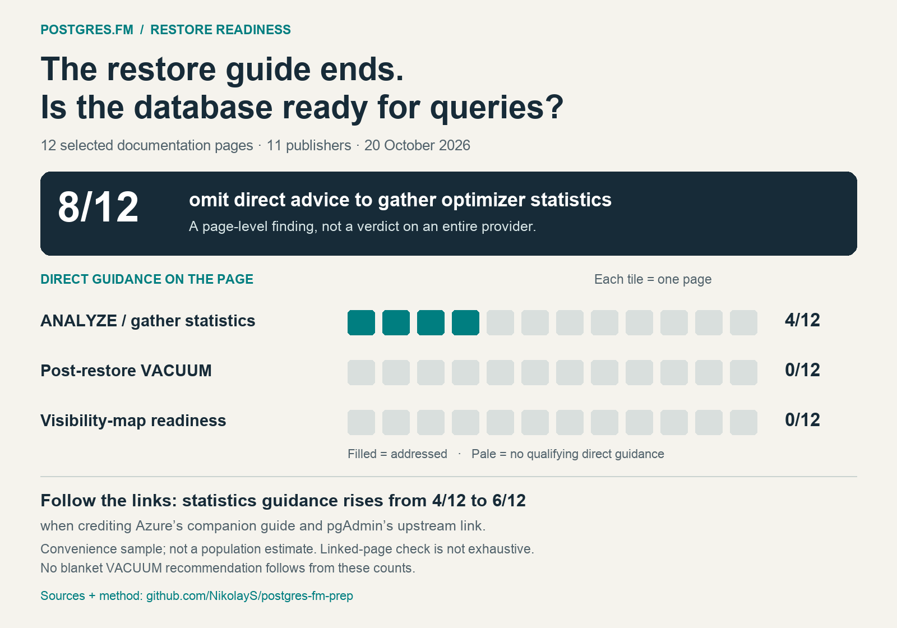

# Do restore guides prepare the database for queries?

Audit date: **October 20, 2026 UTC**. Scope: **12 selected logical restore/import documentation pages**, from 11 publishers: two PostgreSQL core pages and ten provider/tool pages. [Machine-readable CSV](restore-docs-audit.csv) · [JSON with source metadata](restore-docs-audit.json).

## Results

[Download the infographic](assets/restore-docs-audit-summary.png). Counts are generated from the [published dataset](restore-docs-audit.json); [rendering source](assets/render_docs_audit.py).

| Direct guidance on the inspected page | All 12 pages | Ten provider/tool pages | Two PostgreSQL core pages |
| --- | --- | --- | --- |
| Recommends post-restore ANALYZE or gathering optimizer statistics | 4/12 (33.3%) | 2/10 (20%) | 2/2 (100%) |
| Discusses optimizer statistics, including transport | 4/12 (33.3%) | 2/10 (20%) | 2/2 (100%) |
| Recommends post-restore VACUUM | 0/12 (0%) | 0/10 (0%) | 0/2 (0%) |
| Explains post-restore physical visibility-map / index-only-scan readiness | 0/12 (0%) | 0/10 (0%) | 0/2 (0%) |

**Eight of the twelve pages (66.7%) omit direct statistics-gathering advice. None of the twelve directly explains visibility-map readiness after a logical restore.** The four positive statistics examples are PostgreSQL's two pages, DigitalOcean and TigerData. Every row below links to the inspected page; the CSV/JSON records retrieval time, source hashes, section locators and short supporting excerpts.

This is a descriptive result for this sample, not an estimate of all PostgreSQL documentation. We did not measure page traffic, search-market share or popularity rankings. Do not rewrite it as “67% of all restore guides are wrong” or “these providers never document maintenance.”

## Page-by-page findings

“No” means no qualifying direct guidance found in the retrieved article text/code. It does not mean the operation is unnecessary or absent from the provider's service implementation.

| Inspected page | ANALYZE action | Optimizer stats | Post-restore VACUUM | VM readiness | Context |
| --- | --- | --- | --- | --- | --- |
| [PostgreSQL 18 — SQL Dump](https://www.postgresql.org/docs/18/backup-dump.html) | Yes | Yes | No | No | Recommends ANALYZE and explains optimizer statistics; links to maintenance and bulk-loading guidance. |
| [PostgreSQL 18 — pg_restore](https://www.postgresql.org/docs/18/app-pgrestore.html) | Yes | Yes | No | No | Conditional advice; also documents importing statistics already in the archive. |
| [Neon — PostgreSQL Restore Database](https://neon.com/postgresql/administration/restore-database) | No | No | No | No | Example ends with table listing and exiting psql; no direct statistics or VM readiness guidance. |
| [Supabase — Backup and Restore using the CLI](https://supabase.com/docs/guides/platform/migrating-within-supabase/backup-restore) | No | No | No | No | Covers restore steps and platform-specific considerations; none of the four audited topics appears in the page text. |
| [TigerData — Migrate with downtime](https://www.tigerdata.com/docs/migrate/migrate-with-downtime) | Yes | Yes | No | No | All four source tabs include ANALYZE before verification and application restart. |
| [AWS RDS — Importing data from PostgreSQL on an Amazon EC2 instance](https://docs.aws.amazon.com/AmazonRDS/latest/UserGuide/PostgreSQL.Procedural.Importing.EC2.html) | No | No | No | No | Covers dump, target creation and restore; no direct post-restore statistics or VM readiness guidance. |
| [Azure — Migrate using dump and restore](https://learn.microsoft.com/en-us/azure/postgresql/migrate/how-to-migrate-using-dump-and-restore) | No | No | No | No | Main page lacks these topics; explicitly linked best-practices page DOES recommend analysis after restore. See linked-guidance discussion. |
| [Google Cloud SQL — Import and export SQL dump files](https://docs.cloud.google.com/sql/docs/postgres/import-export/import-export-sql) | No | No | No | No | Import workflow and permissions; no direct post-import statistics or VM readiness guidance. |
| [DigitalOcean — Migrate a PostgreSQL database](https://docs.digitalocean.com/products/databases/postgresql/how-to/migrate/) | Yes | Yes | No | No | Recommends ANALYZE for query planning. VACUUM occurs in a linked wiki title, not a direct instruction to vacuum after restore. |
| [Heroku — Heroku Postgres Backups](https://devcenter.heroku.com/articles/heroku-postgres-backups) | No | No | No | No | Visibility section concerns backup connections and credentials, not the visibility map. No direct statistics or VM readiness guidance. |
| [pgAdmin 4 9.18 — Restore Dialog](https://www.pgadmin.org/docs/pgadmin4/9.18/restore_dialog.html) | No | No | No | No | Documents UI controls and success notification; links to upstream pg_dump/pg_restore. No direct maintenance/readiness guidance. |
| [Crunchy Bridge — From Heroku Postgres](https://docs.crunchybridge.com/migrate/heroku_dump_restore) | No | No | No | No | Manual logical migration includes ownership and cutover; advises staging validation but no direct statistics or VM readiness step. Physical-backup section excluded. |

## Links change the interpretation

- **Azure is a material qualification.** Its selected migration guide links to [Best practices for pg_dump and pg_restore](https://learn.microsoft.com/en-us/azure/postgresql/troubleshoot/how-to-pgdump-restore), which explicitly recommends analyzing migrated tables after restore. That page also discusses vacuuming **before the dump**; this is not a post-restore VM recommendation. If that one explicitly linked companion is credited, statistics guidance is available for **5/12 workflows (41.7%)**, leaving **7/12 (58.3%)** without direct guidance or this credited companion. This is a sensitivity check, not an exhaustive crawl of linked pages.
- **pgAdmin links upstream.** Its [Restore Dialog page](https://www.pgadmin.org/docs/pgadmin4/9.18/restore_dialog.html) links to pg_dump and pg_restore documentation. The latter has analysis advice. Crediting both Azure's companion and pgAdmin's upstream link raises coverage to **6/12 (50%)**. Again, this is a named sensitivity check, not a complete multi-hop documentation audit.
- **PostgreSQL does document the mechanism elsewhere.** The two selected core pages link to the maintenance chapter's statistics/autovacuum sections. The [same chapter explains visibility-map maintenance](https://www.postgresql.org/docs/18/routine-vacuuming.html#VACUUM-FOR-VISIBILITY-MAP), and [index-only-scan documentation explains heap checks](https://www.postgresql.org/docs/18/indexes-index-only-scans.html). The finding is that the restore pages do not make the physical-readiness connection directly.
- **DigitalOcean's VACUUM text is a link title.** Its [After Importing section](https://docs.digitalocean.com/products/databases/postgresql/how-to/migrate/#after-importing) recommends ANALYZE and links to a wiki introduction whose title includes VACUUM. A keyword count would wrongly turn this into a direct post-restore VACUUM recommendation.

## Detailed source register — full URLs

These are all twelve pages in the denominator, including the positive examples. Each link identifies the exact inspected page; the section locator describes where to check its restore workflow. The findings apply to the captured version on October 20, 2026 UTC.

### 1. PostgreSQL 18 — SQL Dump

[https://www.postgresql.org/docs/18/backup-dump.html](https://www.postgresql.org/docs/18/backup-dump.html)

- **Inspect:** Restoring the Dump.
- **Finding:** Recommends ANALYZE and explains optimizer statistics; links to maintenance and bulk-loading guidance.
- **Captured:** 2026-10-20T03:42:43.672433+00:00. HTML and extracted-text SHA-256 values are in the [source dataset](restore-docs-audit.json).

### 2. PostgreSQL 18 — pg_restore

[https://www.postgresql.org/docs/18/app-pgrestore.html](https://www.postgresql.org/docs/18/app-pgrestore.html)

- **Inspect:** Notes.
- **Finding:** Conditional advice; also documents importing statistics already in the archive.
- **Captured:** 2026-10-20T03:42:43.920276+00:00. HTML and extracted-text SHA-256 values are in the [source dataset](restore-docs-audit.json).

### 3. Neon — PostgreSQL Restore Database

[https://neon.com/postgresql/administration/restore-database](https://neon.com/postgresql/administration/restore-database)

- **Inspect:** PostgreSQL Restore Database example.
- **Finding:** Example ends with table listing and exiting psql; no direct statistics or VM readiness guidance.
- **Captured:** 2026-10-20T03:42:43.891244+00:00. HTML and extracted-text SHA-256 values are in the [source dataset](restore-docs-audit.json).

### 4. Supabase — Backup and Restore using the CLI

[https://supabase.com/docs/guides/platform/migrating-within-supabase/backup-restore](https://supabase.com/docs/guides/platform/migrating-within-supabase/backup-restore)

- **Inspect:** Restore backup using CLI / Special considerations.
- **Finding:** Covers restore steps and platform-specific considerations; none of the four audited topics appears in the page text.
- **Captured:** 2026-10-20T03:42:45.346534+00:00. HTML and extracted-text SHA-256 values are in the [source dataset](restore-docs-audit.json).

### 5. TigerData — Migrate with downtime

[https://www.tigerdata.com/docs/migrate/migrate-with-downtime](https://www.tigerdata.com/docs/migrate/migrate-with-downtime)

- **Inspect:** Validate your Tiger Cloud service and restart your app.
- **Finding:** All four source tabs include ANALYZE before verification and application restart.
- **Captured:** 2026-10-20T03:42:44.849585+00:00. HTML and extracted-text SHA-256 values are in the [source dataset](restore-docs-audit.json).

### 6. AWS RDS — Importing data from PostgreSQL on an Amazon EC2 instance

[https://docs.aws.amazon.com/AmazonRDS/latest/UserGuide/PostgreSQL.Procedural.Importing.EC2.html](https://docs.aws.amazon.com/AmazonRDS/latest/UserGuide/PostgreSQL.Procedural.Importing.EC2.html)

- **Inspect:** Import procedure.
- **Finding:** Covers dump, target creation and restore; no direct post-restore statistics or VM readiness guidance.
- **Captured:** 2026-10-20T03:42:43.385042+00:00. HTML and extracted-text SHA-256 values are in the [source dataset](restore-docs-audit.json).

### 7. Azure — Migrate using dump and restore

[https://learn.microsoft.com/en-us/azure/postgresql/migrate/how-to-migrate-using-dump-and-restore](https://learn.microsoft.com/en-us/azure/postgresql/migrate/how-to-migrate-using-dump-and-restore)

- **Inspect:** Restore / Next steps.
- **Finding:** Main page lacks these topics; explicitly linked best-practices page DOES recommend analysis after restore. See linked-guidance discussion.
- **Captured:** 2026-10-20T03:42:43.988935+00:00. HTML and extracted-text SHA-256 values are in the [source dataset](restore-docs-audit.json).

### 8. Google Cloud SQL — Import and export SQL dump files

[https://docs.cloud.google.com/sql/docs/postgres/import-export/import-export-sql](https://docs.cloud.google.com/sql/docs/postgres/import-export/import-export-sql)

- **Inspect:** Import data from a SQL dump file.
- **Finding:** Import workflow and permissions; no direct post-import statistics or VM readiness guidance.
- **Captured:** 2026-10-20T03:42:45.163908+00:00. HTML and extracted-text SHA-256 values are in the [source dataset](restore-docs-audit.json).

### 9. DigitalOcean — Migrate a PostgreSQL database

[https://docs.digitalocean.com/products/databases/postgresql/how-to/migrate/](https://docs.digitalocean.com/products/databases/postgresql/how-to/migrate/)

- **Inspect:** After Importing.
- **Finding:** Recommends ANALYZE for query planning. VACUUM occurs in a linked wiki title, not a direct instruction to vacuum after restore.
- **Captured:** 2026-10-20T03:42:44.428497+00:00. HTML and extracted-text SHA-256 values are in the [source dataset](restore-docs-audit.json).

### 10. Heroku — Heroku Postgres Backups

[https://devcenter.heroku.com/articles/heroku-postgres-backups](https://devcenter.heroku.com/articles/heroku-postgres-backups)

- **Inspect:** Restore a Backup / Visibility.
- **Finding:** Visibility section concerns backup connections and credentials, not the visibility map. No direct statistics or VM readiness guidance.
- **Captured:** 2026-10-20T03:42:44.670008+00:00. HTML and extracted-text SHA-256 values are in the [source dataset](restore-docs-audit.json).

### 11. pgAdmin 4 9.18 — Restore Dialog

[https://www.pgadmin.org/docs/pgadmin4/9.18/restore_dialog.html](https://www.pgadmin.org/docs/pgadmin4/9.18/restore_dialog.html)

- **Inspect:** Restore Dialog.
- **Finding:** Documents UI controls and success notification; links to upstream pg_dump/pg_restore. No direct maintenance/readiness guidance.
- **Captured:** 2026-10-20T03:42:43.767902+00:00. HTML and extracted-text SHA-256 values are in the [source dataset](restore-docs-audit.json).

### 12. Crunchy Bridge — From Heroku Postgres

[https://docs.crunchybridge.com/migrate/heroku_dump_restore](https://docs.crunchybridge.com/migrate/heroku_dump_restore)

- **Inspect:** Manual migration / Update DATABASE_URL and exit maintenance mode.
- **Finding:** Manual logical migration includes ownership and cutover; advises staging validation but no direct statistics or VM readiness step. Physical-backup section excluded.
- **Captured:** 2026-10-20T03:42:43.878323+00:00. HTML and extracted-text SHA-256 values are in the [source dataset](restore-docs-audit.json).

### Companion and explanatory sources — outside the denominator

- Azure best practices (credited in the linked-guidance comparison): [https://learn.microsoft.com/en-us/azure/postgresql/troubleshoot/how-to-pgdump-restore](https://learn.microsoft.com/en-us/azure/postgresql/troubleshoot/how-to-pgdump-restore).
- PostgreSQL visibility-map maintenance: [https://www.postgresql.org/docs/18/routine-vacuuming.html#VACUUM-FOR-VISIBILITY-MAP](https://www.postgresql.org/docs/18/routine-vacuuming.html#VACUUM-FOR-VISIBILITY-MAP).
- PostgreSQL index-only scan behavior: [https://www.postgresql.org/docs/18/indexes-index-only-scans.html](https://www.postgresql.org/docs/18/indexes-index-only-scans.html).
- PostgreSQL pg_dump reference, linked by pgAdmin: [https://www.postgresql.org/docs/18/app-pgdump.html](https://www.postgresql.org/docs/18/app-pgdump.html). pgAdmin's pg_restore destination is already listed as sample page 2; do not count it again.

## Follow-up: a second AWS restore guide

Added after the original sample was completed; **excluded from the twelve-page denominator and infographic** because this was a user-supplied follow-up, not part of the original selection.

**AWS Database Migration Guide — PostgreSQL pg_dump and pg_restore utility**

[https://docs.aws.amazon.com/dms/latest/sbs/chap-manageddatabases.postgresql-rds-postgresql-full-load-pd_dump.html](https://docs.aws.amazon.com/dms/latest/sbs/chap-manageddatabases.postgresql-rds-postgresql-full-load-pd_dump.html)

The page's workflow covers export, target database creation, importing with pg_restore, optional roles/users and factors affecting duration. The complete retrieved article contains no ANALYZE recommendation, optimizer-statistics discussion, post-restore VACUUM advice or physical visibility-map explanation. Inspect **Example**, **Import Dump Files**, and **Migrate Database Roles and Users**. Retrieved **2026-10-20T03:49:48.007860+00:00**; source hashes and classifications are in the JSON's supplementary sources.

Together with the RDS EC2-import guide in the main sample, **both AWS pages inspected omit these four topics directly**. This supports a two-page AWS finding, not the claim that every RDS guide omits them or that RDS performs no automatic maintenance. Keep the original sample totals unchanged when using this additional example.

## Method and limits

1. **Selection:** the user-supplied Neon tutorial, two upstream PostgreSQL restore references as a baseline, and logical restore/import guides from AWS, Azure, Google Cloud, DigitalOcean, Heroku, Supabase, TigerData, Crunchy Bridge and pgAdmin. Publishers were selected for relevance and ecosystem coverage, without screening for whether they mention maintenance. Pages were located by subject/site search and current documentation navigation. This is a purposive convenience sample, not a random sample or a “top 12” ranking.
2. **Unit:** one named page, counted once. Mixed physical/logical pages were evaluated for their logical restore workflow. TigerData's four source tabs were read but count as one page. Screenshot-only text, videos and linked pages are outside the primary denominator. Navigation/footer mentions are not advice.
3. **Classification:** ANALYZE action includes conditional recommendations; optimizer-statistics discussion includes import/export but excludes activity counters. Post-restore VACUUM requires an instruction in that phase, not pre-dump maintenance, autovacuum configuration or an analyze-only vacuumdb invocation. VM readiness requires an explanation connecting physical visibility/all-visible state or index-only heap fetches to the restored database. Equivalent wording counts; exact keywords are not mandatory.
4. **Inspection:** read the article/procedure and inspect keyword contexts for analyze/analyse, statistics, vacuum, visibility, all-visible and index-only scans. Heroku's “Visibility” heading concerns connections, while pg_restore's “index only” option description concerns selecting an index to restore; neither describes index-only execution readiness.
5. **Provenance:** every sampled URL returned HTTP 200 during capture. The dataset records UTC retrieval timestamps, original/resolved URLs, SHA-256 of retrieved HTML and extracted text, section locators, short excerpts where useful and classification notes. Full third-party pages are not republished here. Hashes identify the captured bytes; they do not create a publicly accessible immutable archive or prove absence by themselves. Live pages can change, and dynamic HTML can change hashes without changing the article. Revisit the sources before reusing the numbers later.
6. **Interpretation:** an omission is not an incorrect instruction. A UI reference has a different scope from a production recovery runbook. Provider-side automation was not tested. These counts measure what a reader encounters on these pages, not service performance, restoration correctness or every provider's documentation coverage.

## What the episode should say

Suggested wording:

> In our October 2026 audit of twelve selected restore/import documentation pages, eight gave no direct advice to gather optimizer statistics. None directly explained visibility-map readiness after logical restore. Upstream PostgreSQL, DigitalOcean and TigerData did tell readers to analyze; Azure supplied that advice in a linked companion guide.

The practical criticism is that **command success is often the endpoint of the documented workflow, while query readiness remains implicit**. Show the counterexamples and linked-guidance qualifications alongside the count.

Do not replace the gap with a universal instruction to vacuum every restored database before any use. The useful addition is a decision step: verify optimizer statistics; check representative plans and actual VM coverage when index-only workloads matter; decide whether maintenance must finish before traffic. ANALYZE and VACUUM address different state, and PG18 statistics transport and eligible COPY FREEZE change parts of the decision. See the [study pack](study-pack.md) and [bounded experiments](experiments.md).
